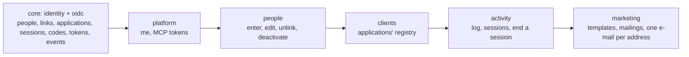
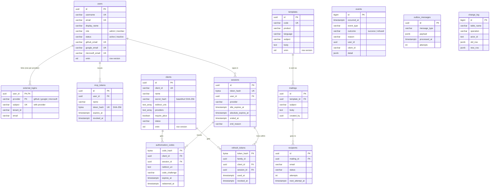
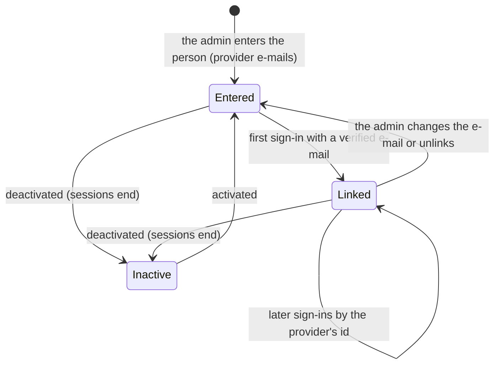
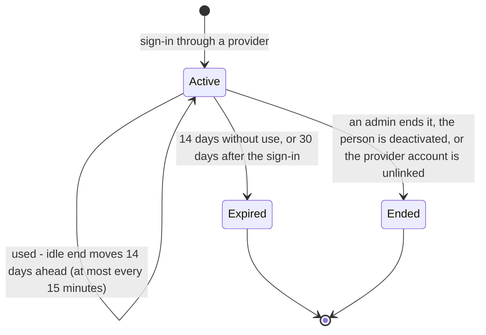
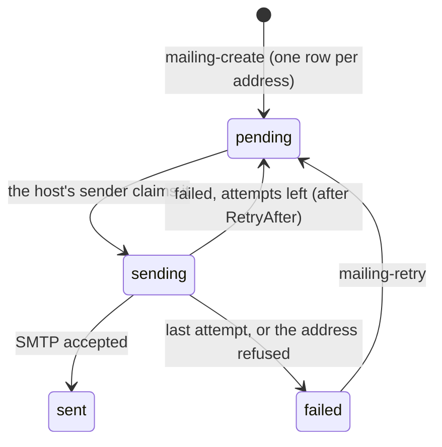

# Domain

People sign in to their team's applications through Great SSO; an SSO admin enters each person (username, work e-mail,
the e-mails of their GitHub, Google and Microsoft accounts). The main aggregate is the **person** with at most one
linked account per provider; applications are registered OpenID Connect clients.

## Modules

One model, one database; a module is a folder of slices in `apps/Sso.Api/Features` over the schemas it works with
(ADR 0005). The core (identity and the protocol's state) is shared by sign-in, the OIDC provider and the modules.

| Module | Tables it changes | Page | MCP tools |
|---|---|---|---|
| core | `identity.external_logins`, `oidc.sessions`, `oidc.authorization_codes`, `oidc.refresh_tokens`, `oidc.events` (sign-in and protocol) | Sign in | - |
| platform | `identity.mcp_tokens` | the shell, Claude Code | - |
| people | `identity.users`, unlinking in `identity.external_logins`, ending sessions | People | `people_list`, `person_*` |
| clients | `oidc.clients` | Applications | `clients_list`, `client_*` |
| activity | ends sessions; reads `oidc.sessions`, `oidc.events` | Activity | `events_list`, `sessions_list`, `session_end` |
| marketing | `marketing.templates`, `marketing.mailings`, `marketing.recipients` | Marketing - Mail | `mail_*`, `mailing*` |

## Tables

Schemas: `identity` (users, external_logins, mcp_tokens), `oidc` (clients, sessions, authorization_codes,
refresh_tokens, events), `marketing` (templates, mailings, recipients), `messaging` (outbox_messages), `audit`
(change_log); `wolverine` holds the runner's message storage.

## A person

## A session

Refresh tokens live within their session: ending it revokes them; a used token coming back revokes its family.

## A mailing (ADR 0014)

## Integration events

None yet: the modules change the core in one transaction, and the log (`oidc.events`) is written in it. The outbox and
the runner are ready for the first one (ADR 0010).
